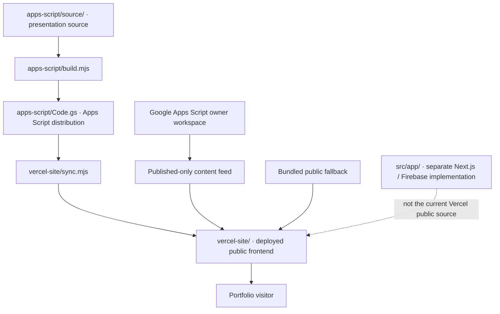

# Kevin Simatupang — Portfolio & Demo Studio

**Project case studies, interactive demonstrations, and a public-facing presentation system.**

The public portfolio is a Vercel-hosted interface generated from a Google Apps Script source workspace. Visitors can explore projects and browser-based demonstrations without signing in. An owner-managed content feed supplies published records; a bundled fallback snapshot supports limited rendering when that feed cannot be reached.

[Visit portfolio](https://portfolio-kevins.vercel.app) · [Demo Studio](https://portfolio-kevins.vercel.app/demos) · [Source](https://github.com/zvenians/kevins-portofolio)

[](https://github.com/zvenians/kevins-portofolio/actions/workflows/ci.yml)

---

## Project intent

A portfolio should do more than name technologies. This project puts selected work into context and offers visitors small, inspectable interactions that demonstrate how a product might behave.

The public experience emphasizes readable case studies, responsive presentation, and hands-on demonstrations. Those demonstrations use **fictional data** unless a case is explicitly linked to a documented real project. The site is not a payments, booking, or production business-management platform.

## What visitors can explore

| Area | Purpose |
| --- | --- |
| **Home** | Introduction, selected work, featured demos, services, and contact paths |
| **Project pages** | Context, technical scope, case-specific imagery, and linked repositories |
| **Studio** | Browser-based demonstrations grouped by type and workflow |
| **Data and operations labs** | Reconciliation, validation, budget, and maintenance examples using sample records |
| **Creative presentations** | Invitation, slide, identity, and visual storytelling directions |
| **Portfolio owner tools** | A separate Apps Script workspace for publishing content and managing owner-owned media |

### Demonstration boundaries

Some demonstrations maintain client-side state and support export or navigation. They do not represent live customer services, financial transactions, authenticated third-party accounts, or actual appointment bookings. Demo screens and seeded data should always be understood as examples.

## Which application is public?

This repository contains **two related but distinct implementations**. They must not be conflated.



### Current public target

- **Source of truth for presentation:** `apps-script/source/` (HTML, CSS, JavaScript, demo modules, project seed).
- **Bundle generation:** `node apps-script/build.mjs` writes `apps-script/Code.gs` and preview assets.
- **Public synchronization:** `node vercel-site/sync.mjs` creates the Vercel template and content-hashed CSS/JS assets.
- **Public runtime:** `vercel-site/` is the Vercel project root.
- **Content:** published project records originate from the owner-controlled Apps Script workspace; the Vercel app also includes a public fallback snapshot.

The root `src/app/` tree is an alternative Next.js/Firebase implementation. Running `npm run build` at the repository root builds **that** application, not the current deployed Vercel presentation.

## Technology

| Layer | Tools in use |
| --- | --- |
| Public experience | HTML, CSS, vanilla JavaScript, Next.js routing |
| Content workspace | Google Apps Script, Google Sheets, private Google Drive assets |
| Build pipeline | Node.js, esbuild, content-hashed generated bundles |
| Separate application | Next.js 16, React 19, TypeScript, Firebase |
| Testing | Vitest, jsdom, Node.js test runner, ESLint |
| Hosting | Vercel for the public presentation |

## Repository structure

```text
.
├── apps-script/
│   ├── source/
│   │   ├── Index.html                 Presentation shell
│   │   ├── Client.js                  Content and interaction
│   │   ├── Gallery.js                 Demonstration registry
│   │   ├── CreativeWorlds.js          Creative demo directions
│   │   ├── StudioSystems.js           Demonstration workflows
│   │   ├── Locale.js                  Language presentation
│   │   ├── Server.gs                  Apps Script backend logic
│   │   └── projects.json              Seed project records
│   ├── build.mjs                       Distribution and preview builder
│   ├── Code.gs                         Generated Apps Script output
│   ├── preview/                        Local browser preview
│   └── tests/                          Core Apps Script tests
├── vercel-site/
│   ├── app/                            Public routing and metadata
│   ├── lib/                            Published feed and fallback handling
│   ├── generated/                      Generated template and fallback snapshot
│   ├── public/                         Hashed assets, images, demo previews
│   ├── sync.mjs                        Source-to-Vercel synchronization
│   └── README.md                       Public target documentation
├── src/                                Separate Next.js / Firebase application
├── tests/                              Unit and interaction tests
├── docs/                               Current visual wireframe and release gates
├── .env.example                        Configuration for the separate app
└── package.json                        Root test and lint tooling
```

## Building the public portfolio

**Prerequisites:** Node.js 24 for current CI parity, npm, and network access for package installation.

Run these commands from the repository root:

```bash
git clone https://github.com/zvenians/kevins-portofolio.git
cd kevins-portofolio
npm ci
npm ci --prefix apps-script
node apps-script/build.mjs
node vercel-site/sync.mjs
npm test
npm run lint
```

The build step regenerates bundled Apps Script assets and local preview files. The sync step uses that output to assemble the Vercel presentation and cached public data snapshot. Review generated diffs and commit the generated files alongside source changes when required.

To start the public Vercel project locally:

```bash
cd vercel-site
npm install
npm run dev
```

The development server uses the Next.js local port (normally `http://localhost:3000`). Some published content requires a configured backend; the bundled fallback exists to handle unavailable content responses.

### Production-target build check

After rebuilding and syncing from the repository root, run:

```bash
cd vercel-site
npm run build
```

This is the relevant build for the public Vercel target. Do not mistake a successful root Next.js build for validation of the deployed portfolio.

## The separate Next.js application

The root `src/app/` tree contains a Firebase-integrated application with its own content model, admin screens, server actions, and route definitions. It remains in the repository but is **not** the source of the Vercel portfolio described above.

The root application uses environment variables from [`.env.example`](.env.example), including public Firebase configuration and server-side credential configuration. These variables should not be blindly copied to the Vercel public target.

If working on that application specifically:

```bash
npm ci
npm run dev
npm run build
```

Review the distinct architecture and deployment requirements before treating it as a public release candidate.

## Tests and review

```bash
npm test
npm run lint
```

The repository's GitHub Actions workflow installs dependencies, runs the Vitest/Node test suites, and checks source linting. Tests cover project content rendering, navigation, editor behavior, studio interactions, gallery states, basic security rules, and selected demo workflows.

Current documentation:

- [Public Vercel target](vercel-site/README.md)
- [Apps Script owner workspace](apps-script/README.md)
- [Canonical design direction](design.md)
- [Cinematic liquid-glass wireframe and motion contract](docs/quality-lock/CINEMATIC_LIQUID_GLASS_WIREFRAME.md)
- [Release gates and verification status](docs/quality-lock/RELEASE.md)

The public design is implemented in `vercel-site/public/atelier/experience.css`. No historical `v43.css`, `v44.css`, or earlier `Design lock v2` should be reintroduced. The current work showcase is centered, uses the real source screenshots, and advances every 1.1 seconds; Demo Theatre advances every 2.4 seconds. Its skill marquee intentionally stays slow.

## Privacy and content

- Public project descriptions should link to verifiable work; fictional demo records must be identified as examples.
- The owner workspace's unpublished records and private media must not be exposed by the public content feed.
- Published media routes should only return content explicitly made public.
- The interaction endpoint in `vercel-site/app/api/events/` accepts a fixed set of event names and project slugs, without adding visitor identifiers or form content. These are runtime logs, **not** a persistent analytics dashboard.
- The presence of contact links, demos, or a resume control does not imply a production contact-delivery, billing, or booking backend.

## Publishing

For approved changes to the public portfolio:

1. For public Atelier layout and motion, edit `vercel-site/public/atelier/` and the canonical [design direction](design.md). For Apps Script presentation or demo engines, edit `apps-script/source/`. Never hand-edit generated bundle strings.
2. When Apps Script source changes, run its builder and Vercel sync process; review the generated diffs. Atelier-only CSS/JS changes do not need generated-source rewrites.
3. Execute tests and lint; build inside `vercel-site/`.
4. Review content privacy, project links, demo behavior, and mobile navigation.
5. Deploy the **correct Vercel project root** only after approval.
6. Validate public routes, project metadata, content fallback, and demo interactions.

An Apps Script backend update follows its own owner-managed release process. A GitHub commit does not update it automatically.

---

**A portfolio intended to be explored, not just scrolled.** Built and maintained by [Kevin Simatupang](https://github.com/zvenians) in Balikpapan, Indonesia.
