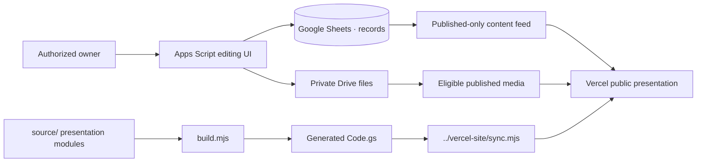

# The Living Index — Apps Script Workspace

**Owner-managed content, media, and the original presentation source for Kevin's public portfolio.**

This directory contains the Google Apps Script edition of the portfolio and the source material used to generate the Vercel presentation. Google Sheets stores structured project content; private Google Drive storage supports approved media and resume files.

[Portfolio overview](../README.md) · [Public Vercel target](../vercel-site/README.md)

---

## Responsibilities

| Area | What this workspace owns |
| --- | --- |
| **Content** | Project records, categories, ordering, visibility, and publication state |
| **Owner tools** | Authenticated editing interfaces and content workflow checks |
| **Media** | Private uploads and public-file eligibility tied to published records |
| **Presentation source** | HTML, CSS, JavaScript, and demo modules under `source/` |
| **Distribution** | Generated `Code.gs`, browser preview, and inputs for Vercel synchronization |

Editing a project record and editing presentation code have different release paths. Approved content updates can be served through the owner workspace without a new public frontend bundle. Changes to presentation JavaScript or CSS require a rebuild and synchronization.

## Data and publication flow



The public frontend must not inherit owner editing permissions. The server-side publication model controls which records and media are public.

## Setup

**Prerequisites:** Node.js, npm, an Apps Script project under an authorized Google account, and permission to review the associated Google Sheets/Drive access.

Run from the **repository root**:

```bash
npm ci
npm ci --prefix apps-script
node apps-script/build.mjs
node --test apps-script/tests/core.test.mjs
```

The build generates `apps-script/Code.gs` and `apps-script/preview/index.html`. Do not manually edit the generated JavaScript and CSS strings in `Code.gs`.

To set up a separate Apps Script environment:

1. Create or select an Apps Script project using the V8 runtime.
2. Review the permissions requested by the script.
3. Add the generated distribution to the Apps Script project.
4. Run the owner setup routine only in a project you control.
5. Verify that private Sheets/Drive objects remain restricted.
6. Deploy a version only after checking owner and anonymous-user boundaries.

The initial setup routine creates project-specific content storage and records IDs in Script Properties. No account credentials should be pasted into source files.

## Project layout

```text
apps-script/
├── source/
│   ├── Server.gs                    Backend, owner access, storage
│   ├── Index.html                   Shared presentation markup
│   ├── Styles.css                   Base design layer
│   ├── Client.js                    Public content and navigation
│   ├── Gallery.js                   Demo registry
│   ├── CreativeWorlds.js            Creative presentations
│   ├── StudioSystems.js             Working demo modules
│   ├── Admin.js                     Owner editing UI
│   ├── Locale.js                    Interface language content
│   ├── data-engine.ts               Pure data calculations
│   └── projects.json                Installation seed records
├── build.mjs                         Distribution and preview generation
├── studio-previews.mjs               Demo snapshot construction
├── Code.gs                           Generated Apps Script distribution
├── preview/index.html                Local browser preview
├── tests/core.test.mjs               Owner/content logic tests
└── package.json                      Workspace dependencies
```

## Content workflow

Project records support ordering, visibility states, and editable case-study content. The editing interface is preferred over raw Sheet modification because it applies validation and concurrency checks.

A publication action should change which records the public feed returns; it should not inadvertently expose drafts, private media, or owner-only settings.

### Media and resume behavior

- Media files may be stored privately in Drive before being attached to a public project.
- Public access to a file should depend on explicit publication state, not merely on possession of a Drive ID.
- Resume publication is a separate action from upload. Replacing a draft must not silently publish it.
- File size and MIME-type restrictions exist in the source, but MIME checks are not antivirus or malicious-file scanning.
- Previously published files and cached public pages must be reviewed after changes to access rules.

Never link directly to a private owner spreadsheet or share its ID in public docs. Keep Drive, Sheets, and script administration details in access-controlled operational records.

## Demonstrations

The portfolio includes creative and data demonstrations using seeded or fictional records. Examples exercise interaction, calculation, and presentation behavior; they are not authoritative finance, scheduling, recruitment, or customer data.

Spreadsheet and PDF export paths may load libraries on demand. Handle unavailable libraries with visible failure states rather than fabricating completed downloads.

A locally generated demo preview is not the same as a live, authenticated end-to-end test.

## Release process

**Presentation change**

```bash
node apps-script/build.mjs
node vercel-site/sync.mjs
npm test
npm run lint
```

Then review generated changes and build the Vercel project as explained in [the public target guide](../vercel-site/README.md). Do not deploy automatically.

**Content change**

Use the authenticated owner interface, confirm the intended visibility, and verify the public feed separately. No frontend source edit is required for ordinary published project records.

**Apps Script backend change**

Create a reviewed Apps Script version, update the intended deployment, and verify anonymous access denial for owner operations. Do not assume a GitHub push changes the running Apps Script version.

## Verification limits

The repository contains automated tests for selected content and demonstration flows. Before calling a production change verified, review private/public media boundaries, resume publication, browser history, a real downloaded export, and behavior on actual devices.

No credentials, private file references, or personal workspace links should appear in repository documentation.

---

**Source maintained by [@zvenians](https://github.com/zvenians).** This is the content and presentation workspace, not a standalone public Vercel deployment.
