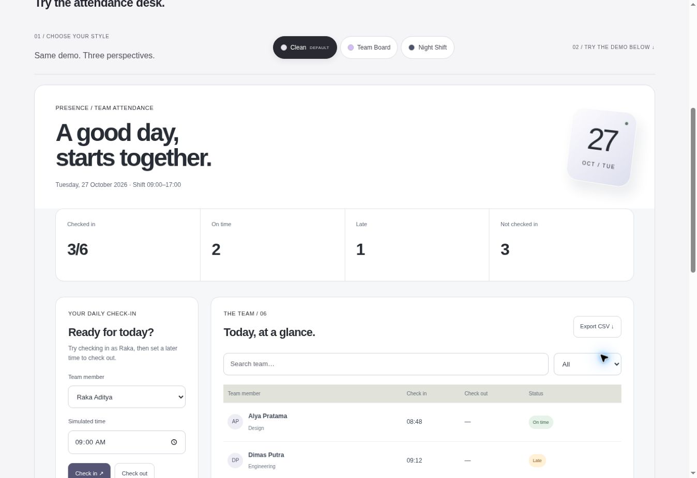

# Demo Studio verification — 27 October 2026

- 72 Vitest tests and 23 core tests passed; production Next build passed.
- Full generated application route smoke check: all 16 interactive project routes expose three style choices; the website category shows six unique cards.
- Live browser: check-in updates 3/6 to 4/6, state survives Team Board and Night Shift, and 17:00 check-out updates the ledger.
- Live browser: manga opens to pages 1–2, advances to 3–4, and retains position when switching Anime Club to Midnight Reader.
- Live browser: Botanical Garden opens the invitation; switching to Wedding Cinema preserves the open content and chapter navigation reaches RSVP.
- Actual screenshots from all four public real-project sites are included in `vercel-site/public/project-shots`, with source URLs recorded there.
- Browser inspection found low-contrast gallery labels and the reader transcript inherited color. Both were corrected, together with spacing between the third comic panel caption and page footer.
- Post-correction: 9 targeted manga/style/attendance tests and all 23 core tests passed.

The image below is a live desktop capture of the Clean attendance demo. All team records are fictional. No attendance data is sent to a server.

