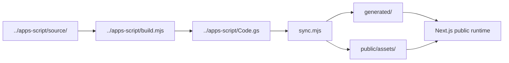

# Portfolio — Vercel Public Target

**The public runtime for Kevin Simatupang's portfolio.**

This directory is the Vercel project root. It serves the portfolio's public presentation, route metadata, published content, and browser-based demonstrations. Presentation code is generated from `../apps-script/source/`; the owner editor is not hosted here.

[Portfolio home](https://portfolio-kevins.vercel.app) · [Main documentation](../README.md) · [Apps Script workspace](../apps-script/README.md)

---

## Runtime responsibilities

| Component | Role |
| --- | --- |
| `app/[[...path]]/route.ts` | Public page routing and rendered HTML |
| `app/og/route.tsx` | Open Graph image generation |
| `app/api/file/route.ts` | Read-only file delivery subject to publication state |
| `app/api/events/route.ts` | Restricted anonymous interaction event logging |
| `app/sitemap.ts`, `app/robots.ts` | Search-engine metadata |
| `lib/content.ts` | Published content retrieval and fallback handling |
| `generated/template.ts` | Generated HTML presentation template |
| `generated/fallback.json` | Bundled snapshot of public records |
| `public/assets/` | Hashed CSS and JavaScript bundles |

The presentation renders from records marked public in the content system. If the feed is unavailable, the bundled snapshot may be used; this does not mean newly edited content is visible until the feed recovers.

## Build path



From the **repository root**:

```bash
npm ci
npm ci --prefix apps-script
node apps-script/build.mjs
node vercel-site/sync.mjs
npm test
npm run lint
```

Then install and verify the public app in its own directory:

```bash
cd vercel-site
npm install
npm run build
npm run dev
```

Do not use the root `npm run build` to verify this target; it builds the separate Firebase-oriented Next.js application in `../src/`.

## Routing and public content

Canonical case-study routes use `/work/:slug`; compatibility routes may redirect older `/projects/:slug` URLs. Studio demonstrations run in the visitor's browser with locally controlled data where described. The public media route should only return files eligible for publication.

### Event endpoint

`POST /api/events` accepts predefined interaction names and allowlisted project slugs. Its purpose is basic interaction observation in Vercel runtime logs. It does not implement a persistent analytics database and should not receive personal form contents, visitor identifiers, or arbitrary URLs.

## Asset handling

- The synchronization script emits minified, content-hashed CSS and JavaScript bundles.
- Commit generated presentation changes together with their source when required by the build process.
- `public/demo-shots/` contains demonstration UI previews; `public/project-shots/` contains real-project screenshots with source references.
- Keep license and attribution files for bundled external materials.

## Deployment controls

This directory must be selected as **Root Directory** in the intended Vercel project. A pull request or local build does not constitute approval to publish production changes.

A reviewed release should verify the correct project, the exact commit, public project routes, social metadata, content fallback, demo controls, and downloadable file eligibility. Owner tokens or Google administrative credentials must not be exposed through this runtime.

## Known boundaries

Apps Script and the owner workspace have their own identity and deployment lifecycle. The public Vercel interface is a presentation and read-only content consumer, not a replacement for the owner editor. Browser demos are intentionally distinct from real customer operations.

---

**Maintained as the public presentation layer of [Kevin's Portfolio](../README.md).**
